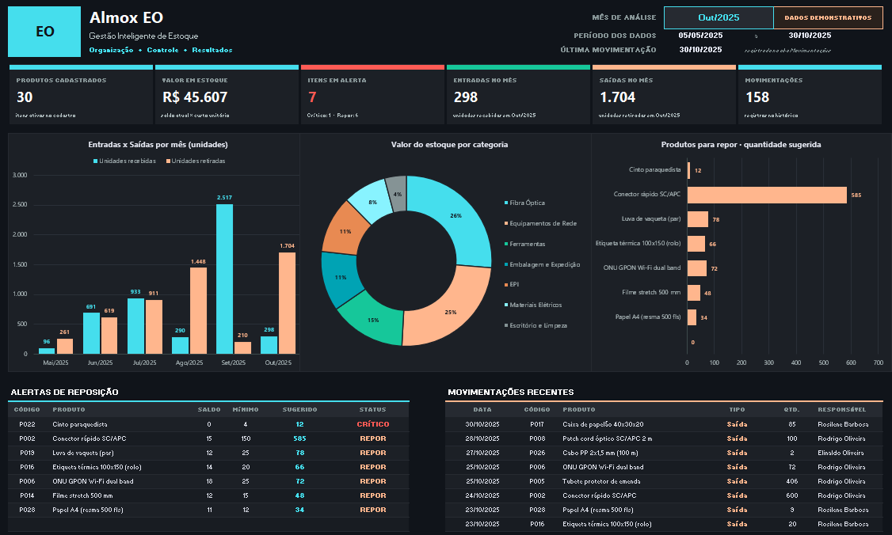

# Almox EO

Controle de estoque feito só no Microsoft Excel, com fórmulas, validação de dados, formatação condicional e gráficos. Não usa macros nem VBA.



## Por que fiz

Trabalhei como conferente e almoxarife, e é comum o controle de estoque ficar em anotações soltas ou em planilhas sem regra. O saldo real só aparece na contagem, a falta de material só é percebida quando a equipe de campo precisa dele e ninguém sabe quanto dinheiro está parado no estoque. Fiz este projeto para praticar uma planilha que calcula essas coisas sozinha.

## O que ele faz

O projeto simula o almoxarifado de uma empresa fictícia, a Conecta Log Serviços e Telecom, que atende a área de logística (embalagem e expedição) e equipes de campo de redes de fibra óptica. Com ele dá para:

- cadastrar produtos com estoque mínimo, estoque máximo e localização;
- registrar entradas e saídas, cada uma com um ID único;
- ver o saldo, o valor em estoque e o status de cada item;
- saber o que precisa ser reposto e quanto comprar;
- acompanhar tudo em um dashboard.

## Abas da planilha

| Aba | O que tem |
|---|---|
| Dashboard | 6 indicadores, gráfico de entradas e saídas por mês, rosca com o valor por categoria, barras de reposição, alertas e últimas movimentações. Tem um seletor de mês. |
| Produtos | 30 itens em 7 categorias. Validações para código único, categoria em lista, números válidos e localização no padrão `A-01-01`. |
| Movimentações | 158 registros, de maio a outubro de 2025. O nome do produto e o saldo do dia aparecem sozinhos. Saldo negativo e ID repetido ficam destacados. |
| Estoque | Saldo, valor, status (CRÍTICO, REPOR ou OK) e quantidade sugerida, tudo calculado. |
| Relatórios | Relatório mensal, por categoria, Top 10 mais movimentados e movimentação por produto. |
| Leia-me | Guia de uso, fórmulas explicadas, limitações e desafios para evoluir o projeto. |

## Regras de negócio

- Saldo atual = estoque inicial + entradas − saídas.
- Valor em estoque = saldo atual × custo unitário.
- Status: CRÍTICO quando o saldo é 0 ou menos, REPOR quando o saldo é menor ou igual ao estoque mínimo, e OK nos outros casos.
- Sugestão de compra = estoque máximo − saldo atual. Só vale para itens em alerta e nunca fica negativa.
- Os alertas aparecem em ordem de cobertura (saldo ÷ mínimo): quem tem menos cobertura vem primeiro.

## O que usei

- Microsoft Excel, pensado para o Excel LTSC 2024 em português do Brasil
- Funções: `SOMASES`, `CONT.SES`, `CONT.SE`, `SOMASE`, `ÍNDICE` com `CORRESP`, `SE`, `SEERRO`, `MENOR`, `MAIOR`, `ORDEM`, `FIMMÊS`, `MÁXIMO`, `CONT.VALORES` e `DESLOC` (para a lista de códigos crescer sozinha)
- Validação de dados com listas suspensas e regras personalizadas
- Formatação condicional
- Gráficos de colunas, rosca e barras
- Filtros, painéis congelados e nomes definidos

Nas listas ordenadas do dashboard (alertas e movimentações recentes) usei `MENOR` e `MAIOR` com uma coluna auxiliar, em vez de `FILTRO` e `CLASSIFICAR`. Assim o arquivo funciona em qualquer versão do Excel.

## Como usar

1. Baixe o `Almox_EO.xlsx` e abra no Excel.
2. Se aparecer o Modo de Exibição Protegido, clique em Habilitar Edição. Sem isso as fórmulas não são calculadas.
3. Cadastre os produtos na aba Produtos.
4. Registre as entradas e saídas na aba Movimentações, usando o "Próximo ID" que aparece no topo.
5. Veja os resultados nas abas Estoque e Dashboard. No dashboard, escolha o mês de análise.

As células brancas são para digitar. As cinza-azuladas têm fórmula e não devem ser editadas.

## Ideias para melhorar

- Proteger as células com fórmula
- Bloquear saídas maiores que o saldo
- Calcular giro de estoque e cobertura em dias
- Listar produtos parados, sem movimentação
- Curva ABC
- Custo médio ponderado
- Uma versão com `PROCX`, `FILTRO` e `CLASSIFICAR`
- Um dashboard em Power BI

## Arquivos do repositório

```
Almox-EO/
├── Almox_EO.xlsx
├── README.md
└── images/
    └── dashboard.png
```

## Aviso

Todos os dados (empresa, produtos, fornecedores, pessoas, valores e datas) são fictícios e servem só para demonstração.

---

Projeto pessoal de portfólio de Elinaldo Oliveira do Nascimento.
